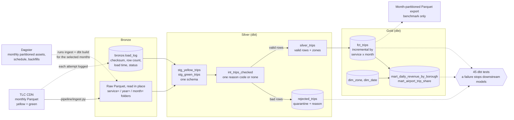

# taxi-lakehouse

[](https://github.com/byteKumar/taxi-lakehouse/actions/workflows/ci.yml)

A batch and incremental pipeline that turns the public NYC TLC yellow and green taxi trip records into tested facts and marts, using DuckDB, dbt and Dagster.

## Results at a glance

All numbers come from [RESULTS.md](RESULTS.md). They were measured on an Apple M3 (8 cores, 16 GB).

- **98,275,510 trips** over 25 months (2024-09 to 2026-09), 1.69 GB of raw Parquet.
- **Reconciliation holds:** bronze 98,275,510 = fct_trips 92,362,220 + rejected 5,913,290, checked for each of the 50 partitions.
- **Full rebuild 35.62 s vs. one new month 6.99 s** (medians of 3, dbt tests included).
- **45 dbt tests:** 44 pass, 1 warns by design, 0 fail.
- **Re-running a month changes nothing:** row counts are identical after two Dagster runs.

## Architecture



The same graph as Dagster draws it:


| Path | What it holds |
|---|---|
| `pipeline/ingest.py` | Download, checksum, atomic replace, `bronze.load_log` |
| `dbt/models/staging/` | `stg_yellow_trips`, `stg_green_trips`: rename and type both services to one schema |
| `dbt/models/silver/` | `int_trips_checked` (reason codes), `rejected_trips` (quarantine), `silver_trips` (valid rows + zones) |
| `dbt/models/gold/` | `fct_trips`, `dim_zone`, `dim_date`, `mart_daily_revenue_by_borough`, `mart_airport_trip_share` |
| `dbt/macros/partitions.sql` | Partition watermark logic for the incremental models |
| `dbt/tests/` | Reconciliation, no future dates, partition month, marts match facts, 2 generic tests |
| `orchestration/definitions.py` | Dagster assets, job, schedule, backfill policy |
| `bench/` | Benchmarks; `bench/results/*.json` holds every measured run |
| `tests/` | pytest: ingest, silver, gold, quality gates, orchestration |
| `ci/sample/` | 8,000-row sample cut from real TLC files, used by CI |

## Approach

| Decision | Why | Trade-off |
|---|---|---|
| **Quarantine instead of drop.** Bad rows go to `rejected_trips` with exactly one reason code (first matching rule wins). | Each raw row ends up in exactly one place, so bronze = valid + rejected can be proven per partition. Rules can be re-checked later without the raw files. | Extra storage for rejected rows (5,913,290 here). The rule order decides which reason a row with several problems gets. |
| **Incremental models driven by a partition watermark.** `meta.partition_watermark` records the bronze load id each (service, month) was built from. A newer load marks that partition stale, and it is deleted and re-inserted. | New months and months TLC republishes are both picked up. Re-runs replace rows instead of appending. The month list is compiled into the SQL, so DuckDB opens only that month's files. | dbt tests still scan whole tables, so they set the floor for an incremental run. Logic changes (for example a new reject threshold) need `--full-refresh`. |
| **Tests block downstream models.** `dbt build` runs each model's tests before its children. Dagster turns dbt tests into asset checks. | A broken partition never reaches the marts. A failing test fails the run with a non-zero exit. | The model that failed its own test is already written. Write-audit-publish (build to staging, test, swap) would fix this at about 2× the disk. |
| **Hive partitions on raw files.** Bronze is the raw Parquet in `service=/year=/month=` folders, read in place. | No copy of the raw data. Month filters skip whole files. | Bronze is only as reliable as the folder layout. Hive types are declared explicitly because auto-detection reads `month=09` as VARCHAR. |
| **Single-run backfills in Dagster.** A range of months runs as one dbt build. | DuckDB allows one writer at a time. | Months are not processed in parallel. |

**Benchmark method.** Every timed run waits until no other benchmark is running on the machine and the 1-minute load average is below 4, and records the load it started at. The full rebuild and the new month ran 3 times each. Each partitioning query ran 5 times per layout, alternating layouts, and results were checked to be identical between layouts. The median is reported, never the best run. Every run is saved in `bench/results/*.json`. The Mac was shared with six other projects, so the gate cannot stop work from starting mid-run.

## Results

### Reconciliation and data quality

| Check | Result |
|---|---|
| Bronze = fct_trips + rejected_trips | 98,275,510 = 92,362,220 + 5,913,290, OK for all 50 partitions |
| dbt tests | 45: 44 pass, 1 warn (`fct_trips_longer_than_24h`, 513 trips), 0 fail |
| Idempotency | 2026-09 run twice through Dagster: 3,922,720 bronze = 3,760,044 fct + 162,676 rejected each time; `sum(trip_id)` unchanged |

### Quarantine by reason

| Reason | Yellow | Green | Total |
|---|---:|---:|---:|
| NEGATIVE_FARE | 3,330,054 | 3,578 | 3,333,632 |
| ZERO_DISTANCE | 2,520,713 | 48,439 | 2,569,152 |
| DROPOFF_BEFORE_PICKUP | 3,506 | 1,351 | 4,857 |
| ABSURD_DISTANCE (> 100 mi) | 4,293 | 355 | 4,648 |
| PICKUP_OUTSIDE_FILE_MONTH | 555 | 446 | 1,001 |
| UNKNOWN_ZONE | 0 | 0 | 0 |
| MISSING_TIMESTAMP | 0 | 0 | 0 |
| **Total** | | | **5,913,290** (6.0% of rows) |

### Full rebuild vs. one new month

Both are `dbt build`, so the times include all 45 tests.

| | Runs | Median |
|---|---|---|
| Full rebuild, `--full-refresh`, 25 months | 23.37 s, 35.62 s, 49.82 s | **35.62 s (0.59 min)** |
| One new month (2026-09, 3,922,720 rows), incremental | 8.07 s, 6.54 s, 6.99 s | **6.99 s (0.12 min)** |
| Download of the new month (68.5 MB) | 1.35 s (once) | |

The incremental run processed only `yellow|2026-09` and `green|2026-09`. The models took about 1.8 s of it; the rest is dbt tests.

### Partitioning: unpartitioned vs. month-partitioned Parquet

`fct_trips` (92,362,220 rows) was exported twice with the same rows, row order, compression and row-group size: one 1.69 GB file vs. 25 month folders (1.75 GB). Each figure is the median of 5 runs.

| Query | Unpartitioned s | Partitioned s | Speed-up |
|---|---:|---:|---:|
| Q1 one month's revenue by pickup borough (2026-03, joins zones) | 0.0437 | 0.0662 | **0.66× (slower)** |
| Q2 airport trip share by service (2026-03) | 0.0300 | 0.0078 | 3.85× |
| Q3 daily trips for one quarter (2026-01..03) | 0.0344 | 0.0098 | 3.51× |
| Q4 yellow tip rate by payment type (2025-07) | 0.0341 | 0.0110 | 3.10× |
| Q5 control: revenue per month, all months, no filter | 0.1431 | 0.0653 | 2.19× |

- **Q1 is slower when partitioned.** EXPLAIN on a 3-month copy shows it still reads only the one month's file. With the Hive filter, DuckDB estimates the trips side of the join at about 1 row, so it builds the hash table on the trips instead of the 265 zones. The query was left as written.
- **Q5 is faster with no filter** because `pickup_month` comes from the folder name, so there is one column fewer to read.

## How to run

Requires Python 3.12. No Docker and no cloud account. Raw data is not in the repo: the first step downloads 1.69 GB.

```bash
python3.12 -m venv .venv && .venv/bin/pip install -r requirements.txt
```

```bash
.venv/bin/python -m pipeline.ingest --start 2024-09 --end 2026-09
```

```bash
cd dbt && ../.venv/bin/dbt build --profiles-dir .
```

To add a month once TLC publishes it (about 6-8 weeks after it ends; 2026-10 shown as an example), ingest it and run the same `dbt build`. Only that month is processed:

```bash
.venv/bin/python -m pipeline.ingest --start 2026-10 --end 2026-10 && (cd dbt && ../.venv/bin/dbt build --profiles-dir .)
```

Dagster UI (assets, lineage, partitions, backfills) at http://127.0.0.1:3000:

```bash
DAGSTER_HOME=$PWD/.dagster_home .venv/bin/dagster dev
```

Benchmarks:

```bash
.venv/bin/python -m bench.bench_refresh full 3
```

Paths are set by environment variables: `TAXI_DATA_DIR`, `TAXI_RAW_DIR`, `TAXI_WAREHOUSE`, `TAXI_BASE_URL`, `TAXI_DUCKDB_MEMORY`. Raw data, the DuckDB file and build outputs are git-ignored.

## Tests and CI

- **22 pytest tests:** ingest against a local HTTP server, dbt models on hand-built rows, quality gates that tamper with data on purpose, and the Dagster job.
- **CI** (`.github/workflows/ci.yml`) runs `scripts/ci_pipeline.sh`, which ingests the 8,000-row `ci/sample/` over HTTP and runs `dbt build` with all tests, twice. It then runs pytest.
- Latest run: [43897711477](https://github.com/byteKumar/taxi-lakehouse/actions/runs/43897711477), passed (pipeline step 55 pass, 1 warn; 22 pytest tests passed).

```bash
.venv/bin/python -m pytest -p no:warnings
```

```bash
scripts/ci_pipeline.sh
```

## Limitations

- **Shared machine.** The full-rebuild runs ranged from 23.37 s to 49.82 s on identical data. `fct_trips` alone took 16.4 s, 17.3 s and 33.9 s. The spread comes from other sessions' load, not from the pipeline.
- **Strong partitioning baseline.** The unpartitioned file was already mostly ordered by month: only 55 of its 752 row groups can contain 2026-03, so DuckDB already skips about 93% of it. A randomly ordered file would show a larger gain.
- **DuckDB file growth.** Three `--full-refresh` runs grew `warehouse.duckdb` from 3.1 to 6.95 GB, because freed blocks are reused but never returned to the OS. Compact by rebuilding into a fresh file.
- **Few runs.** The full rebuild and the new month have 3 runs each. Downloads and Parquet exports were measured once.
- **No write-audit-publish.** A model that fails its own test stays written. Only downstream models are skipped.
- **Schedule not observed firing.** The Dagster schedule was defined and validated, but it has not run on its own yet.
