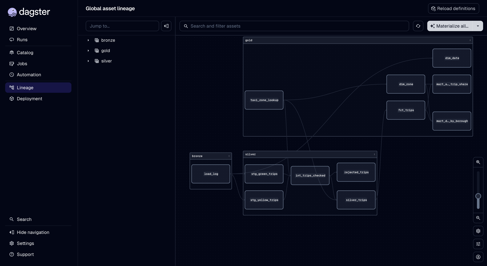

# taxi-lakehouse

A batch and incremental data pipeline over the public
[NYC TLC trip records](https://www.nyc.gov/site/tlc/about/tlc-trip-record-data.page)
(yellow and green taxis, monthly Parquet files). Raw files land in a local
lakehouse in a Hive layout, dbt cleans and models them in DuckDB, 45 data-quality
tests gate every run, and Dagster orchestrates it all as monthly partitions with
a schedule and backfills.

**Measured on an Apple M3 laptop (all numbers in [RESULTS.md](RESULTS.md)):**
- 98.3M trips, 25 months, 1.69 GB raw
- 5.9M bad rows quarantined with a reason code; bronze = silver + rejected holds for every partition
- full rebuild 35.6 s vs. 7.0 s to add one new month (medians, tests included)
- re-running a month leaves every row count unchanged



## How it works

```
TLC CDN ──> bronze: data/raw/service=yellow/year=2026/month=09/*.parquet   (pipeline/ingest.py)
            + bronze.load_log (checksum, row count, load time, status per file)
               │  read in place by DuckDB (no copy)
               ▼
            staging views: rename/type both services to one schema   (dbt)
               ▼
            silver: int_trips_checked (one reject reason or none per row)
                    ├── rejected_trips   (incremental table, quarantined rows + reason)
                    └── silver_trips     (view, valid rows + zone names)
               ▼
            gold:   fct_trips (incremental, partitioned by service x pickup month)
                    dim_zone, dim_date, mart_daily_revenue_by_borough, mart_airport_trip_share
```

- **Bronze ingest** (`pipeline/ingest.py`): downloads each month's files, records
  every attempt in `bronze.load_log`, and is idempotent. A file is skipped when the
  server's ETag/size and the local SHA-256 match the last load, and otherwise replaced
  atomically (download to `.part`, check it is valid Parquet, then `os.replace`).
- **Silver** (`dbt/models/staging`, `dbt/models/silver`):
  - Yellow `tpep_*` and green `lpep_*` columns map to one schema.
  - Columns added over time (`cbd_congestion_fee` in 2025, `request_source` in 2026)
    are filled by an explicit schema contract, so any subset of months builds.
  - Bad rows go to `rejected_trips` with one reason code: `NEGATIVE_FARE`,
    `ZERO_DISTANCE`, `ABSURD_DISTANCE`, `DROPOFF_BEFORE_PICKUP`,
    `PICKUP_OUTSIDE_FILE_MONTH`, `UNKNOWN_ZONE` or `MISSING_TIMESTAMP`.
- **Incremental by partition** (`dbt/macros/partitions.sql`):
  - Each incremental model keeps a high-water mark per (service, month) in
    `meta.partition_watermark`. A partition is stale when bronze has a newer load
    for it: a new month, or a file TLC republished.
  - Stale partitions are deleted and re-inserted, and the month filter reaches the
    Parquet scan, so DuckDB opens only that month's files.
  - `--vars '{"months": [...]}'` forces specific months; Dagster uses this for partitions and backfills.
- **Data quality** (`dbt/models/*/_*.yml`, `dbt/tests/`):
  - standard dbt tests: `unique`, `not_null`, `accepted_values`, `relationships`
  - custom tests: bronze-to-silver+rejected reconciliation per partition, no future
    dates, every trip in its own partition month, marts add up to the fact table
- **Orchestration** (`orchestration/definitions.py`):
  - one monthly-partitioned asset graph; dbt tests become Dagster asset checks
  - a schedule on the 20th that runs the month before last (TLC publishes about 6–8 weeks late)
  - single-run backfills, because DuckDB allows one writer at a time

## Run it

Requires Python 3.12. No Docker, no cloud account.

```bash
python3.12 -m venv .venv && .venv/bin/pip install -r requirements.txt
```

```bash
.venv/bin/python -m pipeline.ingest --start 2024-09 --end 2026-08   # ~1.6 GB download
```

```bash
cd dbt && ../.venv/bin/dbt build --profiles-dir .    # models + all tests
```

New month or backfill, from the CLI or through Dagster:

```bash
.venv/bin/python -m pipeline.ingest --start 2026-09 --end 2026-09 && (cd dbt && ../.venv/bin/dbt build --profiles-dir .)
```

```bash
DAGSTER_HOME=$PWD/.dagster_home .venv/bin/dagster dev   # http://127.0.0.1:3000 -> Lineage / Jobs
```

Tests and benchmarks:

```bash
.venv/bin/python -m pytest -p no:warnings         # 22 tests: ingest, dbt models, quality gates, Dagster
```

```bash
scripts/ci_pipeline.sh                            # what CI runs: ingest + dbt build on an 8,000-row sample
```

```bash
.venv/bin/python -m bench.bench_refresh full 3    # also: new-month <YYYY-MM>, bench_partitioning, check_idempotency
```

Configuration is by environment variable (`TAXI_DATA_DIR`, `TAXI_RAW_DIR`,
`TAXI_WAREHOUSE`, `TAXI_BASE_URL`, `TAXI_DUCKDB_MEMORY`). Raw data, the DuckDB file
and build outputs are git-ignored.

## Results

Full numbers, per-run data and explanations are in [RESULTS.md](RESULTS.md).

| | |
|---|---|
| Scale | 98,275,510 rows, 25 months (2024-09..2026-09), 1.69 GB raw |
| Quality | 45 dbt tests: 44 pass, 1 warn by design (trips > 24 h), 0 fail; 5,913,290 rows rejected; reconciliation OK |
| Full rebuild | 35.62 s median of 3 (23.4 / 35.6 / 49.8 s) |
| One new month | 6.99 s median of 3 (8.1 / 6.5 / 7.0 s), processing only that month |
| Partitioning | 3.1–3.9× faster for one-month queries without joins; **0.66× (slower) for the join query** because of a DuckDB planner estimate; see RESULTS.md |
| Idempotency | same month run twice through Dagster: all row counts unchanged |

## Design trade-offs

- **Bronze is the files, not a table.** DuckDB reads Parquet in place, so the raw
  data isn't copied. The Hive folders give file pruning for free; the cost is that
  bronze is only as reliable as the folder layout.
- **Silver is views; only `rejected_trips` and gold are tables.** This keeps disk to one
  large copy of the trips, at the cost of recomputing silver on read, which is cheap
  because partition filters reach the Parquet scan.
- **Delete-and-insert by partition**, driven by load ids rather than timestamps,
  so republished months are picked up and re-runs are idempotent.
- **No write-audit-publish.** dbt tests run after a model is written, so a failing
  test stops downstream models but leaves the failing model's partition in
  place. Building into a staging table and swapping it in after the tests would close
  this gap, at about 2× the disk.
- **DuckDB never returns freed space to the OS.** Repeated `--full-refresh` runs grow the
  file (3.1 to 6.95 GB in testing); compact by rebuilding into a fresh file.

## CI

`.github/workflows/ci.yml` runs `scripts/ci_pipeline.sh` (real ingest over HTTP
from `ci/sample/`, then `dbt build` with all tests, twice) and pytest. **It has not
run on GitHub yet**: the account's Actions are billing-locked. The script passes locally.

## Layout

```
pipeline/       ingest.py (bronze + load_log), config.py, bronze_report.py
dbt/            models/{staging,silver,gold}, macros/ (bronze reader, partitions), tests/
orchestration/  definitions.py (Dagster assets, job, schedule)
bench/          benchmarks; results/*.json holds every measured run
tests/          pytest: ingest, silver, gold, quality gates, orchestration
ci/sample/      8,000-row sample cut from real TLC files (2024-12 and 2026-06 schemas)
scripts/        ci_pipeline.sh, make_ci_sample.py
```
